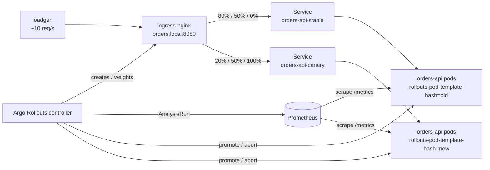

# orders-gitops — progressive delivery with Argo Rollouts on Kind

GitOps-style manifests for a small Node.js **Orders API**, running on a local **Kind**
cluster with **Argo Rollouts** (canary), **ingress-nginx** (real traffic weights) and
**Prometheus** (metric analysis).

The point of the project is not the CRUD API — it is the delivery pipeline, and
specifically this: **a broken release gets rolled back automatically because a
Prometheus query said so, and a healthy one gets promoted because the same query
said so.** Releases are driven by Git: a commit under `apps/orders-api/` is
reconciled by **ArgoCD**, which hands the new revision to **Argo Rollouts**.
Both runs, through both paths, are captured in [`docs/evidence/`](docs/evidence/).

```
$ ./scripts/demo.sh          # kubectl-driven:  promote v2 / auto-rollback v3
$ ./scripts/demo-gitops.sh   # same, but each step is a git commit + push
A. v2 healthy  ->  weight 20% -> 50% -> 100%   AnalysisRun: Successful
B. v3 failing  ->  success-rate = 0            AnalysisRun: Failed -> RolloutAborted
                   traffic stays on v2, ArgoCD shows Degraded, then the release
                   is reverted in Git and the app converges back to Healthy
```

---

## 1. What it demonstrates

| Capability | How |
|---|---|
| GitOps reconciliation | ArgoCD `Application` on `apps/orders-api`, automated sync, drift visible |
| Canary with real traffic weights (not just pod ratios) | ingress-nginx annotations driven by `trafficRouting.nginx` |
| Metric-based promotion **and** rollback | `AnalysisTemplate` querying Prometheus, `successCondition: result[0] >= 0.95` |
| Measurement scoped to the canary only | PromQL filtered on `rollouts_pod_template_hash` |
| Deterministic failure injection | `FAIL_RATE` env var on the same image (0–100 %) |
| Hardened pods | non-root, read-only root filesystem, all capabilities dropped |
| Reproducible from zero | `scripts/bootstrap.sh` (no root, works with rootless Podman) |

## 2. Architecture



The two `ClusterIP` services both select `app=orders-api`. Argo Rollouts **rewrites
their selectors** to add the pod-template hash — that is the only thing that makes
"stable" and "canary" target different pods. Never hardcode that label by hand.

## 3. Prerequisites

Verified on Fedora 44 with **Podman 6.2 in rootless mode** (no Docker daemon, no root),
6 CPUs, 30 GB RAM.

| Tool | Version used | Notes |
|---|---|---|
| kind | 0.33.0 | `KIND_EXPERIMENTAL_PROVIDER=podman` with rootless Podman |
| kubectl | 1.37.1 | |
| helm | 3.19.2 | only for the Prometheus chart |
| node / npm | 22 (in the image) | local tests run with any Node ≥ 20 |
| kubectl-argo-rollouts | v1.10.2 | `~/.local/bin` is enough, no sudo |

In-cluster versions are pinned in `scripts/bootstrap.sh`:
Kubernetes `v1.37.0` (Kind node image), ingress-nginx `controller-v1.15.1`,
argo-rollouts `v1.10.2`, argo-cd `v3.6.2`,
prometheus-community/prometheus chart `30.0.0`.

## 4. Quick start

```bash
git clone <this repo> && cd orders-gitops
git clone <orders-api repo> ../orders-api      # sibling directory

./scripts/bootstrap.sh     # cluster + ingress + rollouts + prometheus + argocd + images + app
./scripts/demo.sh          # the two release scenarios applied with kubectl
./scripts/demo-gitops.sh   # the same two scenarios released through Git + ArgoCD
```

`bootstrap.sh` was verified end to end on a freshly deleted cluster: **~7 minutes**,
no root, no Docker daemon, Podman in rootless mode.

ArgoCD UI (port 8080 is already taken by the ingress on the host):

```bash
kubectl port-forward svc/argocd-server -n argocd 8081:443
open https://localhost:8081          # user: admin
kubectl -n argocd get secret argocd-initial-admin-secret -o jsonpath='{.data.password}' | base64 -d
```

Check the app from the host — the ingress is published on **8080** (privileged
port 80 is not bindable in rootless Podman):

```bash
curl -H 'Host: orders.local' http://127.0.0.1:8080/health
# {"status":"ok","version":"v1","env":"demo","fail_mode":false,"fail_rate":0}

curl -s -H 'Host: orders.local' http://127.0.0.1:8080/api/orders | jq -r .version
```

Watch the rollout:

```bash
kubectl argo rollouts get rollout orders-api -n orders --watch
```

Release a version by hand (this is what a Git commit + ArgoCD sync would do):

```bash
./scripts/deploy-version.sh v2        # healthy
./scripts/deploy-version.sh v3 100    # 100% of /api/orders returns 500
```

## 5. The four traps this project actually solves

These are the reason the repo exists: the naive version of the pipeline either
**never rolls back** or **rolls back the healthy release**. Each one is a line or
two of YAML, and each one is invisible until you run the demo.

### 5.1 Probes and scrapes dilute the success rate

`/ready` (every 3 s), `/live` (every 10 s) and `/metrics` (every 15 s) all return
200 and easily outnumber real traffic on a quiet demo. Aggregate them and a canary
that fails **every** `/api/orders` request still shows ~99 % success.

→ the query only counts `route="/api/orders"`. The app labels the *matched route
pattern*, not the raw path, so label cardinality stays bounded.

### 5.2 Aggregating stable + canary hides the canary

At weight 20 %, a canary failing 100 % of its requests gives a blended success rate
of 80 % — under many thresholds that still "passes" late in a rollout, and the
number tells you nothing about the new version.

→ `args.canary-hash` with `valueFrom.podTemplateHashValue: Latest`, injected into
the query:

```yaml
query: |
  sum(rate(http_requests_total{route="/api/orders", status=~"2..",
       rollouts_pod_template_hash="{{args.canary-hash}}"}[2m])) ...
```

This works because the Prometheus chart's `kubernetes-pods` job labelmaps pod
labels, so `rollouts-pod-template-hash` becomes the metric label
`rollouts_pod_template_hash`.

### 5.3 A cold start reads as a broken release — and where the fallback goes matters

A pod created 40 s ago has fewer than two samples, so `rate()` returns an empty
vector. Argo Rollouts counts that as a **metric error**, and a run of errors aborts
the rollout. Two fixes, in this order:

1. `initialDelay: 45s` + `consecutiveErrorLimit: 8` so a cold start is tolerated;
2. an explicit fallback — but **the placement is the trap**:

```promql
# WRONG: when every request is a 500 there is no 2xx series at all,
# the whole ratio is empty, and the fallback reports 1.0 -- a broken canary looks perfect.
<ratio> or on() vector(1)

# RIGHT: the numerator degrades to 0 *before* the division;
# only a completely empty result (nothing scraped yet) falls back to 1.
(
  (sum(rate(...{status=~"2.."}[2m])) or on() vector(0))
  /
  clamp_min(sum(rate(...[2m])), 0.001)
)
or on() vector(1)
```

A second metric, `canary-request-volume`, makes "the canary receives no traffic at
all" fail loudly instead of passing for a good result.

### 5.4 PromQL operator precedence

`a or vector(0) / b or vector(1)` is **not** `(a or 0) / (b or 1)`. `or` has the
lowest precedence in PromQL, so it parses as `a or (vector(0)/b) or vector(1)`, and
`result[0]` ends up being an absolute request rate compared against `0.95`. Always
parenthesise; `promtool query instant` or the Prometheus UI is the sanity check.

### 5.5 Kind / rootless-Podman specifics that cost time

- **ingress-nginx workers die** with `pthread_create() failed (11)`: the pods
  cgroup allows ~307 pids and nginx starts one worker per CPU. Fixed by
  `worker-processes: "2"` in the controller ConfigMap (see `bootstrap.sh`).
- **Port 80 is not bindable** on the host in rootless mode → Kind maps
  host `8080`/`8443` to the node's `80`/`443`, and every curl needs
  `-H 'Host: orders.local'`.
- **`kubectl apply` fails on the Rollouts CRDs** ("metadata.annotations: Too long")
  → `kubectl apply --server-side`.
- **Image names need a registry prefix.** `kind load docker-image orders-api:v1`
  lands in containerd as `localhost/orders-api:v1`, which a pod asking for
  `orders-api:v1` will not resolve (it looks for `docker.io/library/...`). Building
  and loading `ghcr.io/abi0066/orders-api:v1` fixes it — and it is the reference the
  project will use once images are pushed to GHCR.
- `imagePullPolicy: IfNotPresent` is mandatory, otherwise Kind tries Docker Hub.

## 6. The GitOps loop (ArgoCD)

`platform/argocd/application.yaml` is applied once with `kubectl` — after that, Git
is the only source of truth for `apps/orders-api`:

```yaml
source:
  repoURL: https://github.com/Abi0066/orders-gitops
  targetRevision: main
  path: apps/orders-api
syncPolicy:
  automated:
    prune: false     # Rollouts creates the canary ingress and rewrites the selectors
    selfHeal: false  # an out-of-band deploy-version.sh stays visible as a diff
ignoreDifferences:
  - kind: Service
    jsonPointers: [/spec/selector]
```

Why each choice:

- **`prune: false`** — the `orders-api-orders-api-canary` ingress and the hash in
  the two Services' selectors are created by the Rollouts controller at runtime.
  They are not in Git, and pruning them mid-canary breaks the traffic split.
- **`ignoreDifferences` on `/spec/selector`** — Rollouts owns that field; without
  the exception the Application is permanently `OutOfSync`.
- **`selfHeal: false`** — deliberate for a demo: `scripts/deploy-version.sh` applies
  a version *without* committing, and that must stay visible as `OutOfSync` instead
  of being reverted under your feet. In a real setup you enable it and release only
  through Git.

Two behaviours that look like bugs and are not:

- ArgoCD reports a canary sitting in a pause step as **`Suspended`**, not
  `Progressing`: an app flapping `Suspended → Healthy` during a rollout is normal.
- When the analysis aborts a release, only the *pods* go back — the Rollout **spec**
  still points at the bad version. ArgoCD then shows `Synced` + `Degraded`: Git and
  the cluster agree on what was asked, not on what is serving. The remediation is a
  revert commit, which is exactly what step C of `demo-gitops.sh` does. This is why
  `docs/evidence/07-argocd-auto-rollback.txt` still lists the bad image as
  `(canary)` — at `SetWeight: 0`, with the traffic sample showing 100% of requests
  answered by the previous version.

### repo-server and the inotify limit

Where `fs.inotify.max_user_instances` (128 by default) is already saturated by the
Kind node's own processes, `argocd-repo-server` CrashLoops with:

```
failed to create fsnotify Watcher: couldn't initialize inotify: too many open files
```

`bootstrap.sh` sets `ARGOCD_GPG_ENABLED=false` on the repo-server, which skips the
GPG keyring watcher — no root needed. With root, the general fix is
`sudo sysctl -w fs.inotify.max_user_instances=1024`.

## 7. How the analysis is wired

`apps/orders-api/rollout.yaml` (excerpt):

```yaml
strategy:
  canary:
    stableService: orders-api-stable
    canaryService: orders-api-canary
    trafficRouting:
      nginx:
        stableIngress: orders-api     # Rollouts derives the -canary ingress from it
    steps:
      - setWeight: 20
      - pause: { duration: 90s }
      - setWeight: 50
      - pause: { duration: 90s }
      - setWeight: 100
    analysis:
      templates: [{ templateName: success-rate }]
      startingStep: 1                  # 0-based: start analysing at the 20% step
      args:
        - name: canary-hash
          valueFrom: { podTemplateHashValue: Latest }
```

Debugging commands that were actually useful:

```bash
kubectl argo rollouts get rollout orders-api -n orders
kubectl get analysisrun -n orders -o json | jq '.items[-1].status.metricResults'
kubectl get ingress -n orders -o json | jq '.items[] | {name:.metadata.name, w:.metadata.annotations}'
./scripts/check-analysis-promql.sh <canary-hash>   # runs the query against Prometheus
```

## 8. Repository layout

```
cluster/kind-config.yaml          Kind cluster (ports 8080/8443, ingress-ready label)
platform/prometheus/values.yaml   chart values: no alertmanager/node-exporter/kube-state-metrics
platform/argocd/application.yaml  the ArgoCD Application (GitOps entry point)
apps/orders-api/                  namespace, services, ingress, Rollout, AnalysisTemplate, loadgen
scripts/bootstrap.sh              cluster + platform + ArgoCD + images + app, from zero
scripts/demo.sh                   scenario A (promote) and B (rollback), applied with kubectl
scripts/demo-gitops.sh            same scenarios, released through Git + ArgoCD
scripts/deploy-version.sh         render the Rollout for v1/v2/v3 (+ FAIL_RATE), kubectl apply
scripts/bump-and-push.sh          render + commit + push a release, then wait for ArgoCD
scripts/render-version.py         deterministic manifest rendering (no sed on YAML)
scripts/check-analysis-promql.sh  sanity-check the analysis query against Prometheus
docs/evidence/                    captured output: 01-05 kubectl path, 06-08 GitOps path
```

## 9. Deliberate simplifications

- **The image is identical for v1, v2 and v3.** The release is defined by the tag
  and by `APP_VERSION`/`FAIL_RATE`, so a failure can be reproduced without patching
  code. `FAIL_RATE` accepts any value 0–100, which also allows "the canary degrades
  40 % of its traffic" scenarios that are more realistic than a total outage.
- **Prometheus is the chart, not the operator.** No `ServiceMonitor`, no
  kube-prometheus-stack: the annotation-based pod discovery of the plain chart is
  enough and keeps the cluster small (~1 GB RAM saved).
- **No ingress TLS**, no persistence, single-node cluster: this is a demo rig.

## 10. CI and images

`orders-api`'s GitHub Actions workflow runs the tests, builds the image, scans it
with Trivy and — on `main` only, and only after the scan passes — pushes it to GHCR:

- `ghcr.io/abi0066/orders-api:sha-<commit>` (immutable)
- `ghcr.io/abi0066/orders-api:latest`

The package is publicly pullable — `podman pull ghcr.io/abi0066/orders-api:sha-<commit>`
works with no credentials (verified). Signing is **keyless** (Fulcio certificate from
the workflow's OIDC token + Rekor transparency log, no long-lived key), and buildx
attaches build provenance and an SPDX SBOM as OCI attestations. Verification commands
are in the [`orders-api` README](https://github.com/Abi0066/orders-api#verify-a-published-image);
the short version:

```bash
cosign verify ghcr.io/abi0066/orders-api:sha-<commit> \
  --certificate-identity-regexp 'https://github.com/Abi0066/orders-api/.github/workflows/ci.yml@refs/heads/main' \
  --certificate-oidc-issuer https://token.actions.githubusercontent.com
```

What is deliberately **not** automated: nothing bumps the tag in this repository.
Pinning a release here is a commit (`scripts/bump-and-push.sh`), so a merge upstream
can never deploy by accident — the release step stays explicit.

The demo itself runs locally built `v1`/`v2`/`v3` tags loaded with `kind load`: it
needs three distinguishable versions and no registry credentials at run time. Same
Dockerfile, same bytes. To run against GHCR instead, put a `sha-<commit>` tag in
`apps/orders-api/rollout.yaml` and drop the `kind load` loop from `bootstrap.sh`.

## 11. Not done yet (next increments)

- **No admission enforcement.** Images are signed and verifiable, but nothing in the
  cluster *refuses* an unsigned image — a Kyverno or Connaisseur policy is the next
  step, and it is what would turn "signed" into "only signed images run".
- **No automatic tag bump** — see section 10: releasing is a commit on purpose.
- Progressive delivery of a *database-backed* service (migrations, backwards
  compatibility) is out of scope here.

## 10. Cleanup

```bash
kind delete cluster --name orders-demo
```

Everything else (images, helm repo) lives in the Podman store and `~/.cache`.
